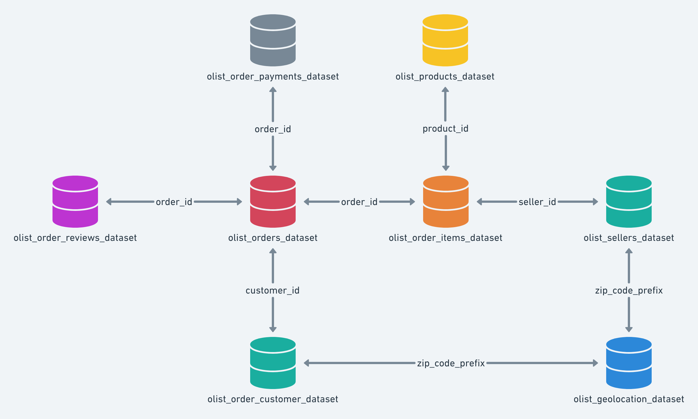

# Olist E-Commerce Analysis with PostgreSQL

An end-to-end SQL project: I load the Olist Brazilian e-commerce dataset into PostgreSQL, validate its quality, add keys and indexes, and answer four business questions about sales, delivery and customer satisfaction.

## Key findings

| # | Question | Answer |
|---|----------|--------|
| 1 | How does monthly revenue evolve? | Revenue grew from ~112K (Jan 2017) to a peak of ~988K (Nov 2017, +52% vs. October). It then fell 26.5% in December and stayed between ~826K and ~978K throughout 2018. |
| 2 | What % of delivered orders arrived late? | **6.79%** arrived after the estimated delivery date. |
| 3 | How does a late delivery affect reviews? | Late orders average **2.27** stars vs. **4.29** for on-time orders. |
| 4 | Which categories generate the most revenue? | `health_beauty` leads with 1.23M, followed by `watches_gifts` (1.16M) and `bed_bath_table` (1.02M). `bed_bath_table` sells the most items (10,945); `watches_gifts` has the highest revenue per item (198.71) among the top 10. |

Notes on the results:

- The November 2017 peak and the December drop are consistent with a Black Friday effect, but the data does not confirm the cause.
- The review gap in question 3 is an association. Late orders may also differ in other ways (distance, seller, product type), so it does not prove that lateness alone causes the lower scores.
- Revenue means the sum of item prices of delivered orders, without freight. There is no cost data, so profit cannot be measured.

## Dataset

[Brazilian E-Commerce Public Dataset by Olist](https://www.kaggle.com/datasets/olistbr/brazilian-ecommerce) (Kaggle): about 100k orders placed between 2016 and 2018 on Olist, a Brazilian marketplace platform. It has 9 tables (customers, sellers, products, orders, items, payments, reviews, geolocation and a category translation table). This analysis uses 5 of them: `orders`, `order_items`, `order_reviews`, `products` and `category_translation`. The other 4 are loaded and validated too, so the database keeps the full original dataset.

The CSV files are not included in this repository. Download them from Kaggle (see *[How to reproduce](#how-to-reproduce)*) and check the dataset's license there before redistributing any data.



*Schema from the Kaggle dataset page. In this project the zip code relationships between customers, sellers and geolocation are not enforced as foreign keys (see *Keys and indexes*).*
*The diagram labels the customers table as `olist_order_customer_dataset`. The file is `olist_customers_dataset`.*

## Repository structure

```
.
├── LICENSE
├── README.md
├── .gitignore
├── images/
│   └── schema.png
├── data/                  # CSV files from Kaggle (not committed)
└── sql/
    ├── 01_schema.sql
    ├── 01b_load_data.sql
    ├── 02_verification.sql
    ├── 03_quality.sql
    ├── 04_constraints.sql
    └── 05_analysis.sql
```

## The scripts

I split the work into several scripts, each with a single purpose, instead of one large `.sql` file.

| Script | Purpose |
|--------|---------|
| `01_schema.sql` | Creates one table per CSV file. |
| `01b_load_data.sql` | Loads each CSV file into its table with `\copy`. |
| `02_verification.sql` | Compares the rows loaded in each table with the number of records in its CSV file. All 9 tables match. |
| `03_quality.sql` | Data quality checks: date coverage, null values, duplicates, orphan rows, invalid values and date logic. Ends with a summary of findings and decisions. |
| `04_constraints.sql` | Adds the primary key of `order_reviews`, six foreign keys and four indexes, once the data has been validated. |
| `05_analysis.sql` | Answers the four business questions. |

## Data quality decisions

### Analysis scope

The analysis uses orders with status `delivered` (96,478 orders, 97.02% of the total), purchased between **January 2017 and August 2018**. This scope is defined once, as the view `orders_in_scope` at the top of `05_analysis.sql`, and all four questions use it, so every result refers to the same set of orders (96,211 orders).

The dataset covers September 2016 to October 2018, but the edges are very thin: 329 orders in 2016 (none in November) and 20 orders in September and October 2018. I could not confirm why, so I treated those months as potentially incomplete and left them out. This removes 267 delivered orders from 2016 (0.28% of delivered orders). No delivered order falls in September-October 2018.

### Multiple reviews

789 `review_id` values appear more than once, and 547 orders (0.55%) have more than one review. The pair `(review_id, order_id)` is unique, so these are not duplicated rows, and it is used as the primary key. Because this affects very few orders, I calculated the average score in two ways: averaging all reviews and averaging one score per order. Both give the same result. Delivered orders without any review (646) are left out of this question.

### Late delivery definition

An order is late if its delivery **date** is after the estimated delivery **date**. I compare dates (`::DATE`) and not timestamps because the estimated date always has a `00:00` time, so timestamp comparison counts an order delivered during the estimated day as late. With timestamps the late rate would be 8.13% instead of 6.79%. The 8 delivered orders without a delivery date are excluded from this question and from the review analysis.

### Products without category or translation

610 products have no category (1.39% of delivered items, 1.29% of revenue). They are real sales, so they are kept and grouped as `unknown`. 13 products from 2 categories have no English translation: `pc_gamer` and `portateis_cozinha_e_preparadores_de_alimentos` (roughly "portable kitchen and food-prep appliances"). They keep their original Portuguese name. The category name is therefore `COALESCE(english, original, 'unknown')`.

### Keys and indexes

`03_quality.sql` found no orphan rows, so six foreign keys were added. Two relationships have no foreign key on purpose: `products` -> `category_translation` (some categories have no translation) and anything involving `geolocation` (zip code prefixes repeat, so there is no key to reference). Four indexes were added on foreign key columns used in joins, because PostgreSQL does not create them automatically.

### Other checks

I also checked payments with zero value or invalid installments, orders without items or payments, and inconsistent date sequences (for example, 166 orders with a carrier date before the purchase date). None of them affects the four questions, so no rows were removed. They are documented in `03_quality.sql` and could support future questions on payments or logistics.

## Limitations

- **No cost data.** Without product costs, profit cannot be calculated, so categories are ranked by revenue (item price, freight excluded). Freight depends on weight and destination and is not part of the product price.
- **Incomplete edge months.** Late 2016 and September-October 2018 are excluded because of their very low volume. The cause is unknown.
- **Early 2017 growth rates.** The growth in February and March 2017 is large partly because it starts from a very small base.

## SQL techniques used

CTEs (including chained CTEs), views, subqueries, window functions (`LAG`, `RANK`), multi-table `JOIN`s, conditional aggregation (`CASE` inside `AVG` and `SUM`, `FILTER`), `COALESCE` and `NULLIF`, data quality checks with `GROUP BY ... HAVING`, and constraints and indexes.

## How to reproduce

1. Install PostgreSQL and create an empty database.
2. Download the dataset from Kaggle and place the 9 `.csv` files in the `data/` folder.
3. From the project root, open `psql`: `psql -d <your_database>`.
4. Run the scripts in order:

```
\i sql/01_schema.sql
\i sql/01b_load_data.sql
\i sql/02_verification.sql
\i sql/03_quality.sql
\i sql/04_constraints.sql
\i sql/05_analysis.sql
```

> `\copy` is a `psql` command, not standard SQL, so the loading step must be run from `psql` and from the project root (the CSV paths are relative). `01_schema.sql` drops and recreates the tables, so the whole process can be repeated safely.

## License

The code is released under the MIT License. The Olist dataset has its own license on Kaggle.
